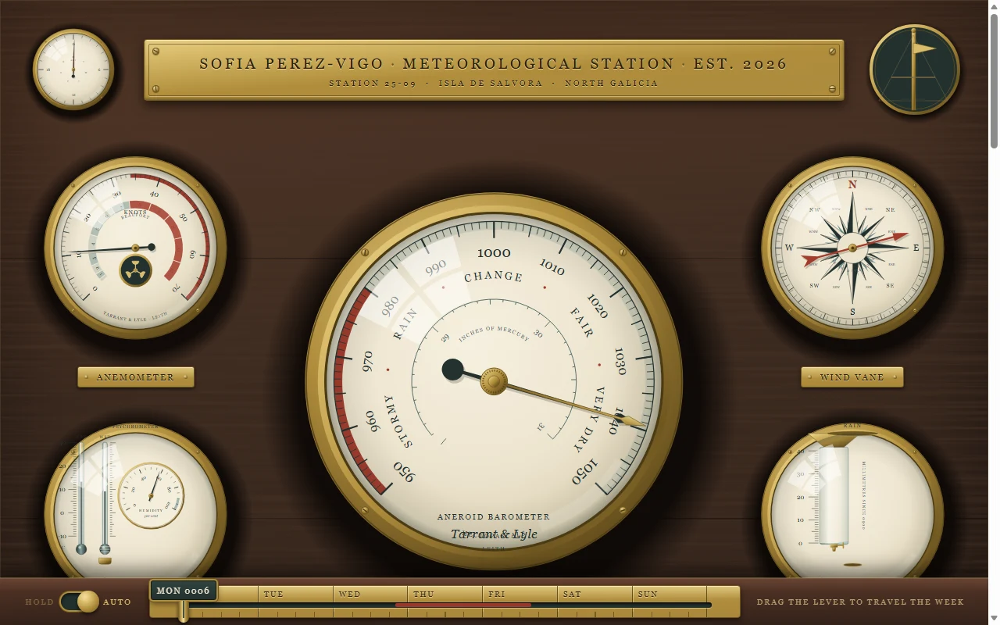

<meta property="og:title" content="METEOSTATION · SOFIA PEREZ-VIGO">
<meta property="og:description" content="Un tablero de instrumentos analógicos de latón y esmalte para una isla inventada del norte de Galicia. Todos los datos son simulados.">
<meta property="og:image" content="https://raw.githubusercontent.com/Hugopvigo/MeteoStation/main/assets/preview.webp">

<p align="center">
  
</p>

<p align="center">
  <b>Un tablero meteorological victoriano para una estación inexistente.</b><br>
  Diez instrumentos de latón y esmalte dibujados en SVG, con agujas que se mueven con inercia real, una tormenta que atraviesa toda la tabla y una semana de tiempo inventado que se reproduce en bucle.
</p>

<p align="center">
  
  
  
  
  
</p>

---

## Qué es esto

**MeteoStation** es un tablero de instrumentos para la estación meteorológica ficticia de **Sofia Perez-Vigo (Station 25-09)**, en la inventada **Isla de Salvora**, al norte de Galicia.

No hay ni un solo recuadro de números: **cada lectura es una aguja**. El tablero es de madera de caoba con veta procedural; los instrumentos son de latón y esmalte, con bisel, tornillos, cristal con reflejo de ventana, escala grabada y el nombre del fabricante inventado *Tarrant & Lyle, Leith*.

Todo lo que se muestra es **ficticio y se genera en la propia página**: una depresión que pasa —la presión cae, el viento rola y sube, llega la lluvia, cruza el frente, la presión sube y el viento vira al noroeste— en una semana simulada que se repite a razón de **1,8 segundos por hora simulada**.

Está publicado en **[hugopvigo.github.io/MeteoStation](https://hugopvigo.github.io/MeteoStation/)**.

## Instrumentos

| Instrumento | Qué hace |
|---|---|
| **Barómetro aneroide** | Escala de 950 a 1050 hPa con las palabras tradicionales STORMY · RAIN · CHANGE · FAIR · VERY DRY, escala interior de pulgadas de mercurio, aguja negra y **aguja de latón arrastrable** para marcar la presión y ver la tendencia. |
| **Anemómetro** | Nudos y anillo de Beaufort, con un pequeño molinillo de copas que gira a la velocidad del viento. |
| **Rosa de los vientos** | 32 rumbos y una veleta roja que busca y rafaguea como el viento real. |
| **Termómetros seco y húmedo** | Tubos de mercurio con escala y un sub-dial de humedad derivada de la depresión del bulbo húmedo. |
| **Pluviómetro** | Cilindro graduado en mm que se llena y se **vacia cada día a las 09:00** con su animación de drenaje. |
| **Barógrafo** | Tambor de relojería en caja acristalada, con un penacho elevado por una pila de aneroides que traza la presión en tinta violeta; se ven tres días en el tambor y los siete en la vista ampliada. |
| **Registrador de sol** | Tarjeta bajo una esfera de cristal que quema el recorrido del sol. |
| **Marea, estado del mar y visibilidad** | Tres diales subsidiarios en un grupo compacto. |
| **Reloj y mástil de señales** | Reloj de 24 horas con mano del día de la semana y mástil en óvalo forrado de bayeta que iza el cono rojo de temporal. |

## El momento de la tormenta

Cada aguja es un **resorte amortiguado** con carácter propio: el barómetro es lento, pesado y ligeramente pegajoso; la veleta es nerviosa; el anemómetro surge en ráfagas. Todas tienen un temblor mínimo que crece con el viento.

Cuando la presión baja de **980 hPa**, toda la tabla reacciona a la vez:

- se iza el **cono rojo** en el mástil —punta abajo para el vendaval del sur, punta arriba cuando el viento vira al noroeste—;
- la luz se atenúa mientras pasan las nubes y cambian los reflejos del cristal;
- aparecen **rayas de lluvia** en los cristales de los instrumentos;
- el cuaderno de bitácora escribe la **aviso de temporal en tinta roja**.

Al tocar el cristal del barómetro, la aguja da un salto, como en un aneroide real.

## Cómo usarlo

Abre `index.html` en cualquier navegador, o visita la versión publicada. No hay build, dependencias ni servidor: es un único fichero autocontenido.

- **Palanca de latón** al pie del tablero: arrastra para viajar por la semana, o usa las flechas (±1 h), PageUp/PageDown (±6 h), Home y End. La franja roja del raíl marca el temporal.
- **Interruptor AUTO / HOLD**: congela o reanuda el reloj.
- **Pasar el cursor** por un instrumento muestra su lectura exacta en una plaquita grabada.
- **Clic en cualquier dial o placa** lo amplía junto a una ficha con la lectura exacta, una nota y el histórico de 24 horas en tinta violeta. En el barómetro, el cristal es para tocar y la placa para ampliar.
- **Sin movimiento**: con `prefers-reduced-motion`, las agujas van directo a su valor, el tambor se detiene y la aguja del penacho recorre el gráfico de la semana.

La rejilla pasa de cuatro columnas a dos y luego a una sola en móvil, con el barómetro primero.

## Estructura

```
index.html          tablero completo: SVG, estilos y simulación en un solo fichero
assets/preview.webp captura 1280×800 del tablero, usada aquí y en el portfolio
LICENSE             Creative Commons Attribution 4.0 International (CC BY 4.0)
DESIGN.md           sistema visual: paleta, tipografía, componentes y motion
PRODUCT.md          contexto de producto y decisiones
```

## Licencia

[Creative Commons Attribution 4.0 International (CC BY 4.0)](https://creativecommons.org/licenses/by/4.0/). Puedes compartir y adaptar el proyecto, incluso con fines comerciales, con atribución, enlace a la licencia e indicando los cambios.

---

Designed by **Hugo Perez-Vigo** · Station 25-09 · Isla de Salvora · North Galicia.
